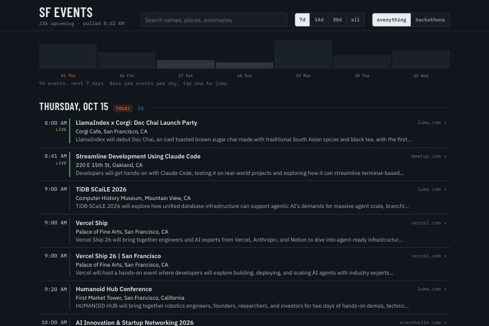

# sf-events-finder

One list of upcoming AI and tech events in the SF Bay Area. Cerebral Valley, Luma and Partiful today, X next. Everything defaults to the Bay Area because that is the only place I am looking.

```bash
uv sync
uv run sf-events                       # next 7 days, grouped by day (pulls first if the store is stale)
uv run sf-events rescrape              # pull every source now
uv run sf-events enrich                # one description pass for sources that have one (luma)
uv run sf-events lookup                # search the web for who scraped guests are (needs keys in .env)
uv run sf-events status                # when each source last ran, description coverage, failures
uv run sf-events --days 30             # further out
uv run sf-events --search hackathon    # filter by name or summary
uv run sf-events --format talk --topic agents   # categories, see below
uv run sf-events --source cerebralvalley        # only what cerebral valley lists
uv run sf-events --sort score --min-score 40    # most worth going first
uv run sf-events --all --json > out.json
```

Output looks like:

```
Thu Oct 15
   8:00 AM  LlamaIndex x Corgi: Doc Chai Launch Party
            Corgi Cafe, San Francisco, CA  ·  https://luma.com/llamai-68ea
   9:00 AM  The Recursive Agents Hackathon [hackathon]
            San Francisco, CA  ·  https://cerebralvalley.ai/e/crusoe-recursive-agents-hackathon
```

## Web UI

```bash
uv run sf-events-web      # http://127.0.0.1:8765
```

One page, same data. Pick a source (all, Luma, Cerebral Valley, Partiful), a range (7, 14, 30 days or everything), click format and topic chips to narrow. Chip counts show what each click would leave. Every row carries a pill per source that lists it, pink for Luma, blue for Cerebral Valley, purple for Partiful, and the time column stripe matches. The bars across the top are events per day, click one to jump to that day. Rows link straight to the registration page. The header shows each source with its count and last pull, and the ↻ button rescrapes it right now.



## Dedupe

Cerebral Valley mostly republishes Luma links, so [sf_events/merge.py](sf_events/merge.py) collapses events across sources at read time. The key is the Luma slug when the URL is a Luma URL, otherwise the URL with tracking stripped. The Luma record wins on fields, Cerebral Valley fills in the summary it wrote, and the merged event carries `also: ["cerebralvalley"]`. In the UI a merged event shows both pills. In the CLI the source column reads `luma`, `cv`, or `luma+cv`. Cerebral Valley listing something is a decent curation signal in a list of 1,200.

## Score

Every event gets a 0 to 100 score for how worth going it looks, with the reasons. It is a weighted keyword list in [sf_events/score.py](sf_events/score.py), nothing smarter: cash prizes (plus a dollar figure of 10k or more), investors, founders, hiring, exclusivity, a notable host, hackathon or demo format, Cerebral Valley curation. Sold out takes 40 off, remote and non-tech filler take some off. The weights are the whole model, tune them there.

```bash
uv run sf-events --days 14 --sort score --min-score 40
```

In the UI: sort by score, a "worth it" filter at 40, the number on every row and the reasons under it.

## Saving events

The star on every row saves the event to a `saved` table on the server, keyed like dedupe so it follows the event across sources. The `saved` button in the top bar shows only starred events, any date, and keeps showing a saved copy after the event leaves every source. `sf-events --saved` lists the same set. `GET /api/saved`, `PUT` and `DELETE /api/saved/{key}` behind it.

## Guest lists and who is in the room

Guest lists on Partiful and Luma are only visible logged in, so they come from a small Chrome extension in [extension/](extension/) rather than the scraper. Load it unpacked (`chrome://extensions`, Developer mode, Load unpacked, pick the `extension` folder). On any Partiful or Luma event page, open the guest list and click the `guests → sf-events` button in the corner. It scrolls the list until it stops growing, extracts name, bio and links per guest, and posts them to `POST /api/guests` on the local server.

The server keys the list the same way dedupe keys events, so it lines up with whichever source has the event. [sf_events/people.py](sf_events/people.py) tags each guest from their bio (investor, founder, exec, researcher, engineer, student, host, plus `@org` for a notable company) and gives the event counts and a notable list. Investors and founders in the room add up to 25 points to the score. In the UI the row shows `212 guests · 3 investors · 14 founders` and `who` opens the notable people with their links.

Both extractors are built against real guest lists. Partiful rows carry a bio, so that is what gets analyzed. Luma's guest modal has names and social links but no bios, so the server fills them from Luma's public profile API (`api.luma.com/user/profile?username=...`): short bio, LinkedIn, X, website, and how many events the person has hosted. Hosting three or more earns a `host` tag, since that is a connector. The lookups run three wide and stop at the first 429, so a huge list may come back partly described.

## Who they are, from the web

Most people never write a bio, so there is a third layer that searches for them. It is off unless `.env` has both keys:

```
FIRECRAWL_API_KEY=...   # search
ANTHROPIC_API_KEY=...   # reading the results
```

Per guest, cheapest first: a LinkedIn slug in their links becomes one exact search whose result title is their LinkedIn headline. Otherwise a full name plus an X or Instagram handle becomes an anchored web search, and only results that mention the handle, or the name on LinkedIn, are kept. A first name alone with no handle is skipped, since there is no honest way to find "Aidan". Then Claude reads the evidence in batches and returns role, company, headline, whether they are worth meeting, and how confident it is, with instructions to answer unknown when the evidence could be a different person with the same name.

Results live in a `people` table keyed by the strongest anchor, so someone seen at three events costs one lookup, and misses are remembered. The web server runs one bounded pass per minute while any list has work (60 searches, about 120 Firecrawl credits), `sf-events lookup [key]` runs a pass by hand, and the panel has a `look up more` button. Code in [sf_events/lookup.py](sf_events/lookup.py).

## Categories

Cerebral Valley only labels its own hackathons, so categories are keyword rules over the name and summary in [sf_events/categorize.py](sf_events/categorize.py). Two axes:

- **format**, one per event, first matching rule wins and the title is checked before the summary: hackathon, conference, workshop, demo, talk, social, meetup, or other.
- **topics**, any that match: agents, coding, infra, data, robotics, security, founders, research, health, open source, design.

On a 236 event pull, 13 fell through to other. If that gets annoying the next step is a small model pass over the leftovers, not more regex.

## Store and rescrape jobs

Scraped events live in `data/events.db` (SQLite, gitignored, override with `SF_EVENTS_DB`). Each source has its own interval in [sf_events/sources/__init__.py](sf_events/sources/__init__.py), 30 minutes for Cerebral Valley. A rescrape replaces that source's rows with what it returned and logs a row in `runs` with count, added, removed, and any error. A failed pull keeps the old rows.

Enrichment is a second, cheaper job per source: it rewrites stored rows with descriptions and tags, never adds or removes, and has its own interval (6 minutes) and its own rows in `runs` with `job = 'enrich'`. It stops scheduling itself once every row in the window has a summary.

Three ways a rescrape happens:

- `sf-events rescrape [source]` runs one now.
- `sf-events` (list) first pulls any source past its interval, `--stale` skips that.
- the web server runs a background thread that checks every minute and pulls whatever is due. The ↻ button in the UI calls `POST /api/rescrape/{source}`.

`sf-events status` and `GET /api/status` show per source: count, last successful pull, last error, next due. See [sf_events/store.py](sf_events/store.py) and [sf_events/jobs.py](sf_events/jobs.py).

## Sources

**luma** The map at luma.com/ai/map is fed by a public discover endpoint that takes a bounding box, so one box over the Bay Area walks every discoverable event behind every dot, no slug and no clicking:

```
GET https://api.luma.com/discover/get-paginated-events?west=-122.7&east=-121.7&south=37.2&north=38.1&pagination_limit=50[&pagination_cursor=...]
```

About 1,200 upcoming events, 50 per page, no auth. Entries carry no description, so a second pass fetches `GET https://api.luma.com/url?url=<slug>` for events starting in the next two weeks and keeps the description (clipped to a short summary) and Luma's own category tags, which show up as topics (`ai`, `tech`, `arts & culture`). That endpoint allows about 70 calls before a 429 and then blocks for around five minutes, so each pass fetches at most 60, soonest events first, and stops at the first 429. Rows already in the store keep their summary, so each event costs one detail call ever. The pass runs as its own job every 6 minutes (`sf-events enrich`, or the web server's scheduler), so the two-week window fills in within about an hour of a fresh start. Roughly a quarter of the Luma events Cerebral Valley lists are not marked discoverable and never appear here, which is why both sources stay. See [sf_events/sources/luma.py](sf_events/sources/luma.py).

**partiful** `partiful.com/events` wants a login, but `partiful.com/explore/sf` is a public server-rendered page with every curated Bay Area event embedded in its `__NEXT_DATA__`: a trending carousel, themed sections, a short feed. About 75 events, no pagination, and the category params return the same set. The section an event sits in becomes its tags. Mostly social, so the score sorts it out. See [sf_events/sources/partiful.py](sf_events/sources/partiful.py).

**cerebralvalley** The events page is a Next.js app that fills itself from a public JSON API, so the scraper calls that instead of parsing HTML:

```
GET https://api.cerebralvalley.ai/v1/public/event/pull?approved=true&locations=BAY_AREA&startDateTime=<utc iso>&limit=100&offset=0
```

Pages cap at 100. Timestamps are naive strings in UTC. Most entries are Luma links the Cerebral Valley team approved, a handful are their own hackathons. See [sf_events/sources/cerebralvalley.py](sf_events/sources/cerebralvalley.py).

Adding a source means one module with `fetch(start, end) -> list[Event]` and a `Source(name, fetch, every)` line in [sf_events/sources/__init__.py](sf_events/sources/__init__.py). It gets its own rescrape job, status row, and header chip for free. `Event` is in [sf_events/models.py](sf_events/models.py).

## Tests

```bash
uv run pytest
```
